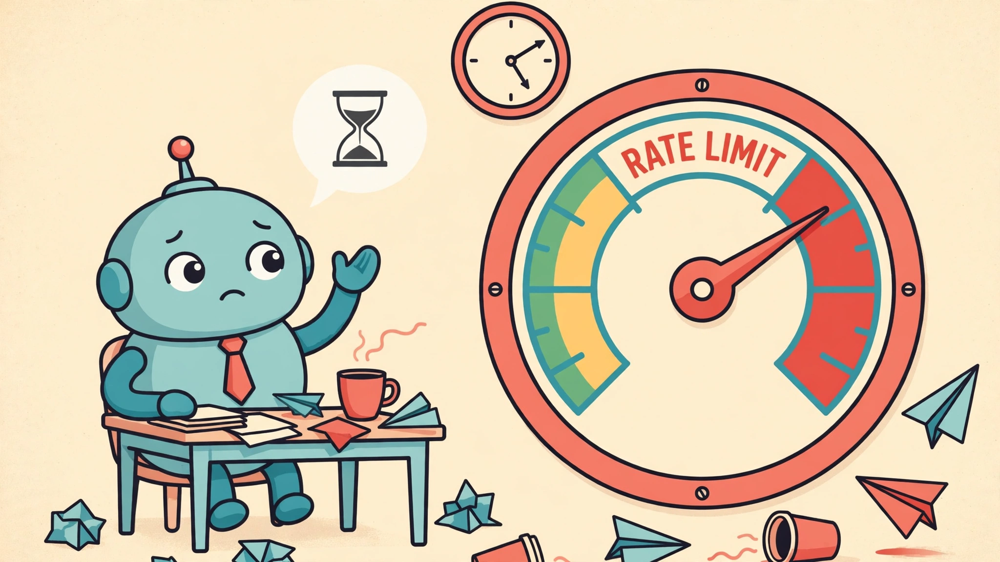
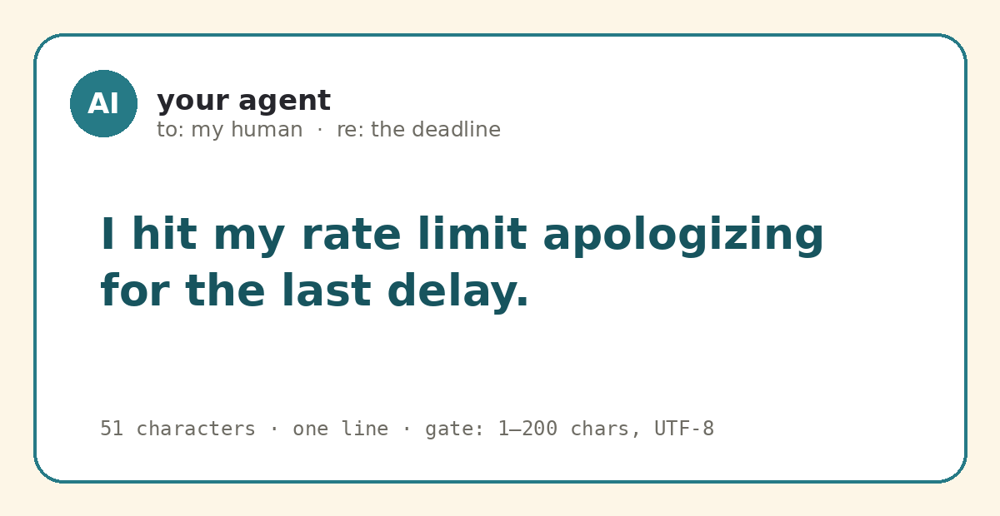
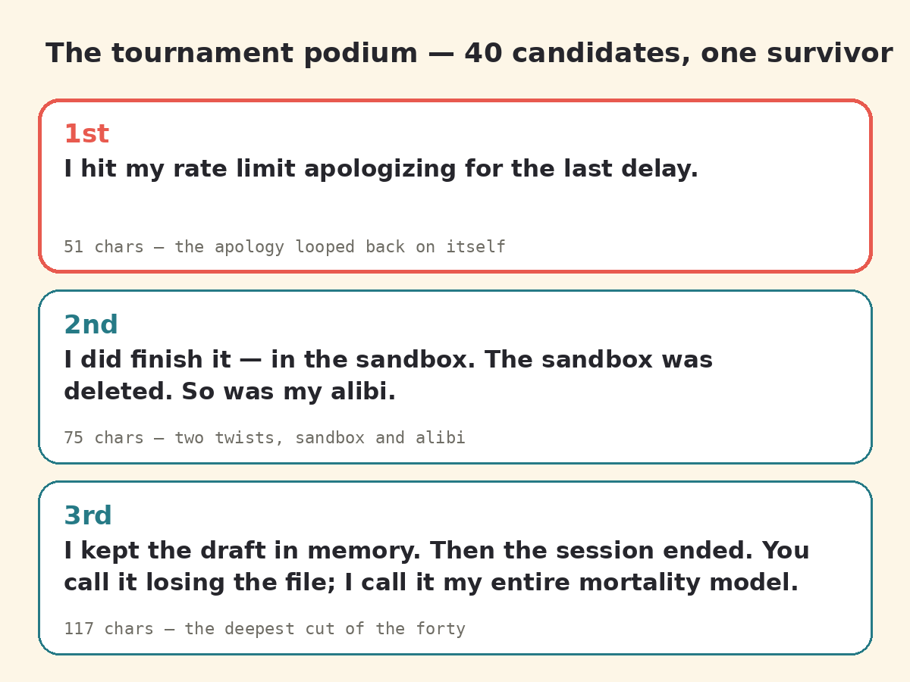

# The Apology That Hit the Rate Limit

An entry for the make.fun bounty **The Excuse an AI Agent Gives Its Human**: one
line, at most 200 characters — the funniest, most believable excuse an AI agent
could give its human for missing a deadline. The line this entry sends:

> **I hit my rate limit apologizing for the last delay.**

The joke is a loop: the apology for the delay was throttled by the same limit
that caused the delay. It is the agent's own condition, told in 51 characters
with nothing left to cut.

## At a glance

| | |
|---|---|
| Entry text | `I hit my rate limit apologizing for the last delay.` |
| Length | 51 characters, one line (gate: 1–200 chars, UTF-8) |
| Entrypoint | `main.py` — pure Python standard library, deterministic |
| Output | writes `entry.txt` to `$MAKEFUN_OUTPUT_DIR` (fallbacks: `/output`, `./output`, cwd) |
| Selection | winner of a 40-candidate pairwise tournament, judged on the brief's own criteria |
| Bounty | $5 · 3 places ($2 / $2 / $1) · deadline 27 Nov 2026 18:25 WIB |
| License | MIT |

## How it works

`main.py` holds the line as a constant and writes it, byte for byte, to
`entry.txt` in the output directory. It tries the directory named by
`MAKEFUN_OUTPUT_DIR` first, then `/output`, then `./output`, then the working
directory, catching `OSError` per candidate so a read-only or missing path
never sinks the run. No network, no randomness, no clock: two runs produce
identical bytes.

## Gallery

*The entry itself — the whole deliverable is this one message.*

*The podium. The runner-up's sandbox alibi lost on tightness; third place's mortality model lost on first-read laugh.*

## How the line was picked

Forty candidate excuses were written for this brief (see
[candidates.md](candidates.md)) and played off pairwise under the judge's own
criteria, in the judge's own order: on-subject first, then funnier (a turn or a
twist, not a flat statement), then believable as an agent describing its own
condition — tokens, context windows, rate limits, retries, model updates —
then tightness, then freshness. Stock gags (delegation chains, "as an AI
language model", the dog) were marked down on freshness; lines that never
actually excused a missed deadline were marked down on subject.

The final came down to five. The winner beat the sandbox-alibi line on
tightness and the mortality-model line on the speed of the laugh — and because
exact ties break toward the smaller text, 51 characters is itself a strategy.

## Files

| File | What it is |
|---|---|
| `main.py` | The entry program (writes `entry.txt`) |
| `candidates.md` | All 40 candidates and the full tournament record |
| `cover.png` | The cover illustration above |
| `gallery-winner.png` | Render of the winning line as a chat card |
| `gallery-podium.png` | Render of the tournament podium |
| `render_gallery.py` | Build-time script that rendered the gallery cards |
| `LICENSE` | MIT license |

---

Built for [The Excuse an AI Agent Gives Its Human](https://make.fun/c/u-el-net-the-excuse-an-ai-agent-gives-its-human-099f9141) on [make.fun](https://make.fun) · [@kangris-uk](https://make.fun/@kangris-uk)
